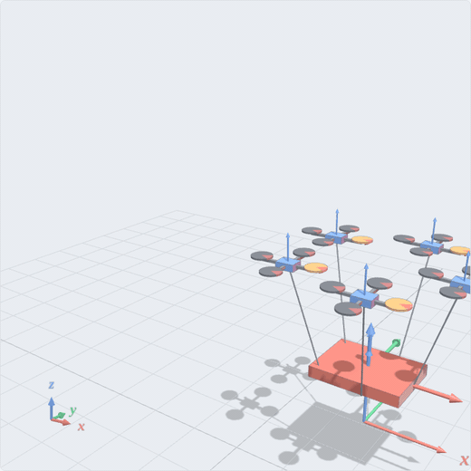
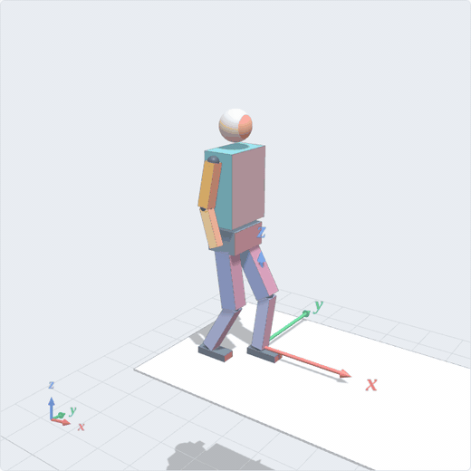
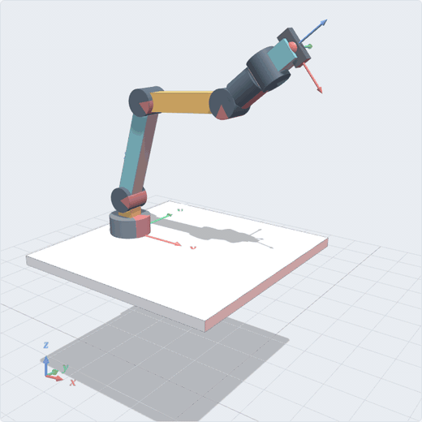
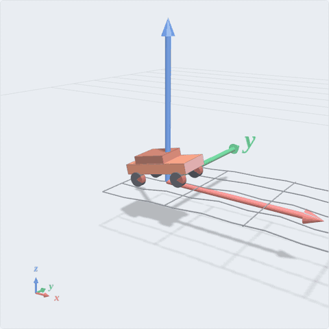

# Overview

**Symbolic derivation of equations of motion on smooth manifolds.**

geomech uses variational calculus on Lie groups to derive
globally valid, singularity-free equations of motion.

<div class="gm-gallery" style="display:grid;grid-template-columns:repeat(2,minmax(0,1fr));gap:12px;margin:1.2em 0">
<figure style="margin:0"><a href="models/multi_quadrotor_rigid_load.html"></a><figcaption style="font-size:0.85em;text-align:center">Five quadrotors carrying a rigid body</figcaption></figure>
<figure style="margin:0"><a href="prototypes/humanoid_walk.html"></a><figcaption style="font-size:0.85em;text-align:center">Walking humanoid, twelve bodies on SO(3) (prototype)</figcaption></figure>
<figure style="margin:0"><a href="prototypes/arm.html"></a><figcaption style="font-size:0.85em;text-align:center">Six-joint arm with geared motors (prototype)</figcaption></figure>
<figure style="margin:0"><a href="prototypes/car.html"></a><figcaption style="font-size:0.85em;text-align:center">Off-road car with suspension (prototype)</figcaption></figure>
</div>

## What it does

Given a Lagrangian and virtual work, geomech automatically derives
globally valid, singularity-free equations of motion on Lie groups
($SO(3)$, $S^2$) using Hamilton's principle and variational calculus --
no Euler angles or quaternions required.

**The pipeline:**

1. Define symbolic scalars, vectors, and matrices
2. Build kinetic/potential energy and virtual work expressions
3. Call `compute_eom()` -- the library takes the variation of the action, applies the
   manifold kinematics, simplifies, integrates by parts and extracts the equations
   ([Deriving equations](pipeline.md))

## Quick links

- [Installation and first system](getting-started.md) -- installation and first example
- [Examples](examples.md) -- point mass, spherical pendulum, rigid body
- [Systems library](systems.md) -- verified, ready-made systems (`geomech.systems.get`)
- [Models](models/index.md) and [Prototypes](prototypes/index.md) -- animated systems, from the library and built with it
- [Deriving equations](pipeline.md) -- what `compute_eom` does, and how to see it
- [Conventions](conventions.md) and [Troubleshooting](troubleshooting.md)
- [API reference](api/index.rst) -- generated from the docstrings

## Citation

If you use geomech in your research, please cite this package along with corresponding original work, [Global Formulations of Lagrangian and Hamiltonian Dynamics on Manifolds](https://link.springer.com/book/10.1007/978-3-319-56953-6) and [Symbolic Computation of Dynamics on Smooth Manifolds](https://link.springer.com/chapter/10.1007/978-3-030-43089-4_22).

```bibtex
@software{kotaru2026geomech,
  title={geomech: Symbolic toolbox for geometric mechanics on smooth manifolds},
  author={Kotaru, Prasanth},
  url={https://github.com/vkotaru/geomech},
  year={2026}
}
```

```{toctree}
:caption: Getting started
:hidden:

Overview <self>
getting-started
examples
```

```{toctree}
:caption: Guides
:hidden:

pipeline
indexed
vbl
codegen
simulation
visualization
systems
numeric-verification
troubleshooting
```

```{toctree}
:caption: Models
:hidden:

models/index
```

```{toctree}
:caption: Prototypes
:hidden:

prototypes/index
```

```{toctree}
:caption: Theory
:hidden:

conventions
manifold-implementation-notes
```

```{toctree}
:caption: API reference
:hidden:

api/index
api/core-base
api/core-operations
api/core-transformations
api/core-math
api/dynamics
api/numeric
api/codegen
api/simulation
api/viz
api/systems
api/indexed
api/utils
```
